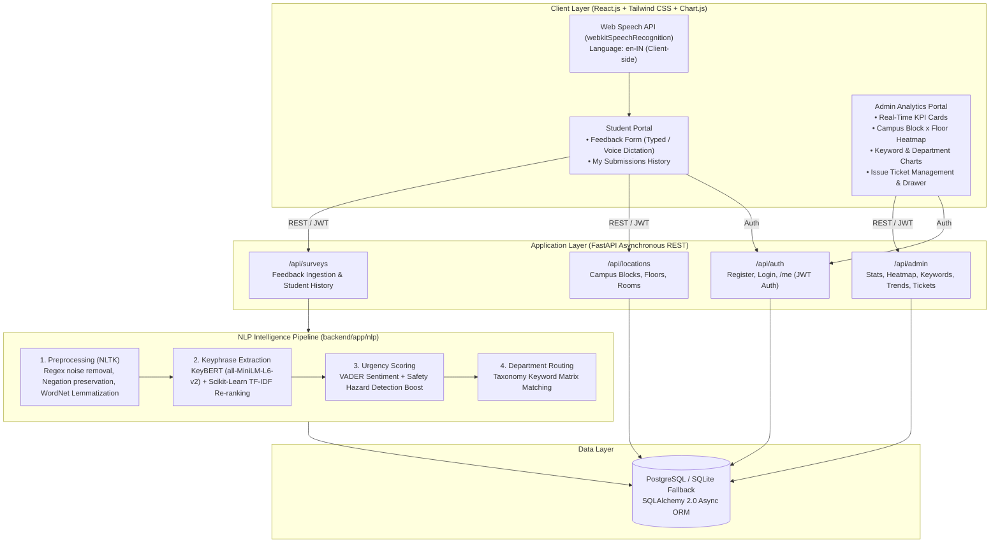

# Campus Feedback Intelligence System
### J.C. Bose University of Science & Technology, YMCA, Faridabad

An intelligent full-stack campus facility feedback processing system for B.Tech Capstone. Students submit open-ended feedback through typing or browser speech recognition (`en-IN`). An asynchronous NLP pipeline extracts key phrases, analyzes sentiment, scores issue urgency with safety hazard detection, and automatically dispatches tickets to the appropriate university maintenance departments. Administrators have access to an analytics dashboard featuring campus heatmaps, frequency statistics, trend charts, and ticket workflow controls.

---

## Architecture Diagram



---

## NLP Pipeline Explanation

The intelligence engine lives in `backend/app/nlp/` and executes the following sequential stages:

1. **Preprocessing (`preprocess.py`)**:
   - Cleans URLs, HTML markup, non-ASCII artifacts, and punctuation.
   - Preserves critical negation markers and facility condition terms (e.g., `not`, `no`, `broken`, `damaged`, `leaking`, `slippery`, `burning`).
   - POS tagging with NLTK and WordNet lemmatization to canonical forms.

2. **Keyphrase Extraction (`keywords.py`)**:
   - Leverages **KeyBERT** initialized with `all-MiniLM-L6-v2` embeddings using Maximal Marginal Relevance (MMR) for diversity (ngram range 1 to 3).
   - Combines semantic scores with **TF-IDF** domain weighting (0.7 KeyBERT + 0.3 TF-IDF) to re-rank and extract the top 5 keyphrases.
   - Singleton pattern caches models on startup to ensure instant request response times.

3. **Urgency & Hazard Scoring (`urgency.py`)**:
   - Calculates the VADER compound sentiment polarity score $c \in [-1, 1]$.
   - Maps compound score to urgency:
     $$\text{urgency\_score} = \frac{1 - c}{2} \in [0, 1]$$
   - Applies threshold categorization:
     - $< 0.35$: **Low** (Green)
     - $< 0.55$: **Medium** (Amber)
     - $< 0.75$: **High** (Orange)
     - $\ge 0.75$: **Critical** (Red)
   - **Safety Hazard Boost**: Evaluates text for critical safety terms (`exposed wire`, `short circuit`, `sparks`, `fire`, `flooding`, `gas leakage`, `collapse`, `slippery`, `snake`, `injury`, etc.). If detected, automatically elevates urgency to at least **High** and boosts the urgency score.

4. **Department Routing (`routing.py`)**:
   - Matches keywords and tokens against taxonomy dictionaries for university wings:
     - **Electrical Maintenance Wing**: switchboard, wire, fan, light, short circuit, power, socket, AC, voltage, spark, tripping.
     - **Public Health and Civil Works**: leakage, water, washroom, toilet, wall, ceiling, bench, furniture, drain, cleanliness, slippery.
     - **IT Services**: projector, wifi, internet, computer, lab pc, network, software, display, monitor.
     - **General Administration**: Fallback category.
   - Multi-word phrases receive higher weight (2 points) compared to single terms (1 point). The department with the highest score is assigned.

---

## Database Schema

- **Users**: `user_id` (PK), `name`, `email` (unique), `password_hash` (bcrypt), `role` (`student` | `admin`), `created_at`.
- **Locations**: `location_id` (PK), `block_name`, `floor`, `room_number`.
- **Surveys**: `survey_id` (PK), `user_id` (FK), `location_id` (FK), `raw_text`, `input_mode` (`typed` | `voice`), `created_at`.
- **AnalysisResults**: `analysis_id` (PK), `survey_id` (FK), `cleaned_text`, `extracted_keywords` (JSON), `sentiment_compound`, `urgency_score`, `urgency_level` (`Low` | `Medium` | `High` | `Critical`), `assigned_dept`.
- **IssueTickets**: `ticket_id` (PK), `analysis_id` (FK), `status` (`Pending` | `In Progress` | `Resolved`), `created_at`, `resolved_at`.

---

## Demo Credentials

| Role | Email | Password |
|---|---|---|
| **Student** | `student@demo.com` | `demo1234` |
| **Admin** | `admin@demo.com` | `demo1234` |

*(Pre-populated with 15 campus locations across Block A, Block B, Block C, Library, and Labs, and 60 realistic feedback entries spread across the last 60 days).*

---

## Setup & Run Instructions

### Option A: Standard Local Setup (No Docker Required)

#### 1. Backend Setup
```bash
# Navigate to backend directory
cd backend

# Install dependencies
pip install -r requirements.txt

# (Optional) Seed the database with 60 realistic campus records
python seed.py

# Run backend tests
python -m pytest tests/ -v

# Start FastAPI backend server
python -m uvicorn app.main:app --host 127.0.0.1 --port 8000 --reload
```
The backend will run on `http://127.0.0.1:8000`. Interactive API documentation is available at `http://127.0.0.1:8000/api/docs`.

#### 2. Frontend Setup
```bash
# Navigate to frontend directory
cd ../frontend

# Install dependencies
npm install

# Start Vite development server
npm run dev
```
Open `http://localhost:5173` in your browser.

---

### Option B: Docker Compose Setup

```bash
# From the project root directory
docker-compose up --build
```
This launches:
- **PostgreSQL Database** on `localhost:5432`
- **FastAPI Backend** on `localhost:8000`
- **React Frontend (Nginx)** on `localhost:5173`

To seed the database inside Docker:
```bash
docker-compose exec backend python seed.py
```

---

## API Summary

| Method | Endpoint | Access | Description |
|---|---|---|---|
| `POST` | `/api/auth/register` | Public | Register new student or admin account |
| `POST` | `/api/auth/login` | Public | Authenticate and obtain JWT token |
| `GET` | `/api/auth/me` | Authenticated | Retrieve current user profile |
| `GET` | `/api/locations` | Authenticated | Fetch campus blocks, floors, and rooms |
| `POST` | `/api/surveys` | Student | Submit feedback (runs NLP pipeline and creates ticket) |
| `GET` | `/api/surveys/mine` | Student | Retrieve own feedback submission history |
| `GET` | `/api/admin/stats` | Admin | Total feedback, critical issues, pending tickets, % resolved |
| `GET` | `/api/admin/keywords` | Admin | Frequency ranking of extracted keyphrases |
| `GET` | `/api/admin/heatmap` | Admin | Issue counts categorized by Block $\times$ Floor |
| `GET` | `/api/admin/trends` | Admin | Daily issue volumes for selected timeframe |
| `GET` | `/api/admin/department-distribution` | Admin | Aggregate counts by maintenance department |
| `GET` | `/api/admin/tickets` | Admin | Paginated ticket queue with filters (status, dept, urgency) |
| `PATCH` | `/api/admin/tickets/{id}` | Admin | Update status (`Pending`, `In Progress`, `Resolved`) |

---

## Verification Test Samples

The system has been verified against the standard test cases:

1. **Sample 1 (Civil Works)**
   - *Input*: `"There is water leakage in the ceiling of Lab 3 and the floor is very slippery"`
   - *Result*: Assigned to **Public Health and Civil Works**, Urgency: **High**
2. **Sample 2 (IT Services)**
   - *Input*: `"The projector in room 204 is not working and the wifi is very slow"`
   - *Result*: Assigned to **IT Services**, Urgency: **Medium**
3. **Sample 3 (Electrical Maintenance)**
   - *Input*: `"Exposed wires near the switchboard outside the library, very dangerous"`
   - *Result*: Assigned to **Electrical Maintenance Wing**, Urgency: **Critical**
